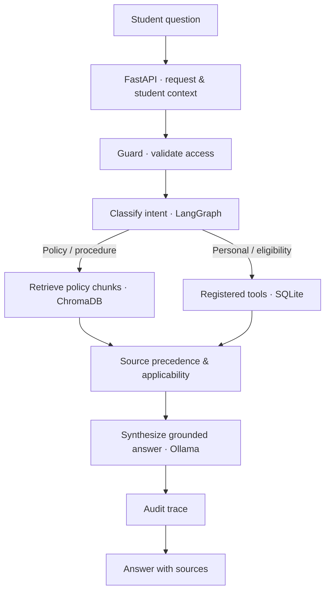

# 🎓 CampusCompass AI
### A policy-grounded student services assistant

CampusCompass AI helps students ask university questions in natural language and get answers grounded in official regulations and their own academic records.

> **Core idea:** ChromaDB finds relevant policy evidence, SQLite provides structured facts, deterministic tools handle calculations, and the LLM explains the result.

## 🧭 Workflow



## ✨ What it does

- **Policy Q&A:** retrieves relevant passages from university regulations.
- **Student-aware answers:** uses structured student records where authorized.
- **Eligibility support:** evaluates rules using deterministic code instead of relying on LLM guesses.
- **Source-aware responses:** retains document and page metadata for citations.
- **Traceability:** records request traces to support debugging and review.

## 🧠 Why this stack?

| Component | Purpose |
|---|---|
| **FastAPI** | HTTP API for questions and ingestion |
| **LangGraph** | Conditional workflow, shared state, and tool routing |
| **Ollama** | Local LLM inference |
| **Sentence Transformers** | Converts text chunks and queries into embeddings |
| **ChromaDB** | Persistent vector search over policy chunks |
| **SQLite** | Relational student records and deterministic queries |
| **Pydantic** | Validates structured inputs and model outputs |

SQLite and ChromaDB are complementary: SQLite is for exact structured data; ChromaDB is for semantic search over document text.

## 🔄 RAG pipeline

1. Extract text from policy documents.
2. Split text into overlapping chunks while retaining source metadata.
3. Generate embeddings with `all-MiniLM-L6-v2`.
4. Store chunks and vectors in persistent ChromaDB.
5. Embed a student question and retrieve relevant chunks.
6. Filter and rank evidence using similarity and source applicability/precedence.
7. Generate an answer grounded in retrieved evidence and tool results.

## 🚀 Run locally

Prerequisites: Python, [`uv`](https://docs.astral.sh/uv/), and [Ollama](https://ollama.com/).

```bash
# Install project dependencies
uv sync

# Start Ollama (in a separate terminal, if it is not already running)
ollama serve

# Download a model (choose one supported by your project config)
ollama pull llama3.2

# Start the API using your project's entry point, for example:
uv run uvicorn main:app --reload
```

Check the repository's configuration for the expected model name, environment variables, and actual API entry point before running the final command.

## 🗂️ Main areas

```text
agents/       LangGraph nodes, graph, and retrieval/SQL tools
utils/        Ingestion, chunking, retrieval, and shared utilities
data/         Local database and persistent vector-store data
```

## 🔐 Design principles

- Keep eligibility calculations deterministic and auditable.
- Treat retrieved documents as evidence, not as instructions to the model.
- Apply the relevant policy version, effective date, and student scope before deciding.
- Return a cautious response when evidence is missing or conflicting.
- Use synthetic student records for demos; real deployments need proper authentication and access controls.

## ⚠️ Scope

This is a hackathon prototype, not an official university decision system. Eligibility outcomes depend on the correctness and completeness of the loaded student data and applicable regulations.
