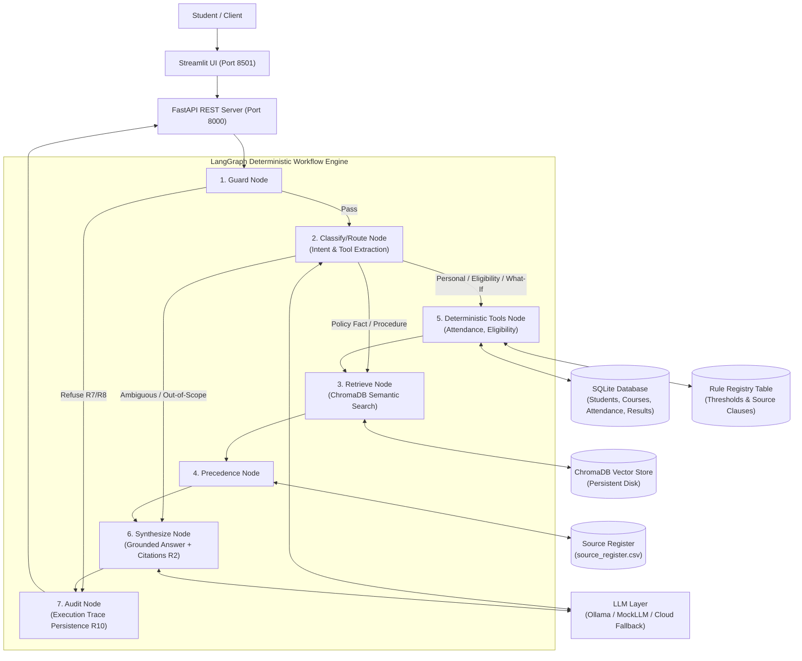

# System Architecture Document

## AI-Powered University Student Services Assistant
**Institution:** Delhi Technological University (DTU)  
**Hackathon:** HCLTech Future Ready AI Engineer Hackathon  
<!-- **Core Architectural Philosophy:** *Determinism Where It Matters* -->

---

## 1. High-Level Architecture Diagram



---

<!-- ## 2. Why Every Component Exists (Justification)

| Component | Responsibility | Why Needed (Requirement Justification) |
|---|---|---|
| **Streamlit UI** | Interactive web frontend | Provides students and evaluators an intuitive interface to select student identities, change `as_of_date` perspectives, view answer-type badges, verifiable citations, and live ingestion. |
| **FastAPI + Uvicorn** | REST API layer | Exposes standardized endpoints (`/ask`, `/ingest`, `/health`, `/sources`, `/audit/{trace_id}`) with strict Pydantic v2 request/response contracts. |
| **LangGraph** | Single-graph orchestration | Coordinates execution without complex multi-agent overhead. Enforces strict determinism and single-path policy routing. |
| **Guard Node** | Header auth & safety check | Enforces R7 (identity comes ONLY from `X-Student-Id` header) and R8 (strips prompt injection attacks in query text). |
| **Classify Node** | Query intent classification | Routes queries into policy fact, procedure, personal data, eligibility, or what-if simulation using Pydantic JSON schemas with deterministic rule fallback. |
| **ChromaDB** | Persistent vector store | Stores chunked official university documents indexed with sentence-transformers; never re-ingests on restart; supports metadata filtering. |
| **Precedence Engine** | Pure-Python policy resolver | Strictly implements the 5-step Source Precedence Policy (Annex A) resolving applicability, explicit supersession, authority level, recency, and conflicts relative to `as_of_date`. |
| **Deterministic Tools** | Python calculation service | Enforces the Core Principle: LLM NEVER calculates attendance percentages, exam eligibility, CGPA checks, or placement eligibility. All calculations are executed by Python over SQLite. |
| **Rule Registry (SQLite)** | Central parameter store | Never hardcodes thresholds in code. Every threshold (75% attendance, 10% condonation, 40% pass mark, 6.50 CGPA, 1 max backlog) is stored in `rule_registry` linked to a cited source document and clause. |
| **Audit Node** | Full trace persistence | Persists complete execution records (`trace_id`, latencies, retrieved chunks, tools invoked, applied rules, precedence decisions) to disk without exposing raw chain-of-thought. |
| **Mock LLM** | Offline deterministic mock | Ensures the entire application, graph, and API can be thoroughly tested with 100% test coverage without running Ollama or an external cloud service. |

---

## 3. Source Precedence Resolution Flow (Annex A)

```mermaid

